# Workspace Dependency Graph

*Which workspace projects depend on each other?*

```mermaid
---
config:
  theme: dark
  layout: elk
---
flowchart LR
    subgraph group_infra["infra"]
        ws_0["zyplux"]
    end
    subgraph group_prod["prod"]
        ws_1["zyplux-setup-pm"]
        ws_2["zyplux-airlock"]
        ws_3["zyplux-cerberus"]
        ws_4["zyplux-clipy"]
        ws_5["cz"]
        ws_6["token-stats"]
        ws_7["totchef"]
        ws_8["eslint-config"]
        ws_9["spectra"]
        ws_10["tsconfig"]:::foundation
        ws_11["util"]
    end
    ws_0 ws_0__ws_5@--> ws_5
    ws_0 ws_0__ws_8@--> ws_8
    ws_0 ws_0__ws_9@--> ws_9
    ws_3 ws_3__ws_2@--> ws_2
    classDef ws_3_edges stroke:#b167e4,stroke-width:2px
    class ws_3__ws_2 ws_3_edges
    ws_4 ws_4__ws_2@--> ws_2
    ws_4 ws_4__ws_3@--> ws_3
    classDef ws_4_edges stroke:#e467d3,stroke-width:2px
    class ws_4__ws_2,ws_4__ws_3 ws_4_edges
    ws_5 ws_5__ws_11@--> ws_11
    classDef ws_5_edges stroke:#e4678f,stroke-width:2px
    class ws_5__ws_11 ws_5_edges
    ws_8 ws_8__ws_11@--> ws_11
    classDef ws_8_edges stroke:#bce467,stroke-width:2px
    class ws_8__ws_11 ws_8_edges
    classDef foundation fill:#2b2b2b,stroke:#888,stroke-dasharray:5 5
```

Solid arrows are declared workspace dependencies; dashed arrows have only type imports in TypeScript source.

## Foundations

Imported by at least 40% of workspaces (5/12):

- **`tsconfig`** ← `zyplux`, `cz`, `eslint-config`, `spectra`, `util`

Generate with `cz workspace-graph`.
