# Workspace Dependency Graph

*Which workspace projects depend on each other?*

```mermaid
---
config:
  theme: dark
  layout: elk
---
flowchart LR
    subgraph workspaces
        subgraph group_0["apps"]
            ws_0["zyplux-setup-pm"]
            ws_1["zyplux-airlock"]
            ws_2["zyplux-cerberus"]
            ws_3["clipy"]
            ws_4["cz"]
            ws_5["token-stats"]
            ws_6["totchef"]
        end
        subgraph group_1["packages"]
            ws_7["eslint-config"]
            ws_8["spectra"]
            ws_9["tsconfig"]
            ws_10["util"]
            ws_11["zyplux-util"]
        end
    end
    ws_2 ws_2__ws_1@--> ws_1
    classDef ws_2_edges stroke:#e467c9,stroke-width:2px
    class ws_2__ws_1 ws_2_edges
    ws_4 ws_4__ws_9@--> ws_9
    ws_4 ws_4__ws_10@--> ws_10
    classDef ws_4_edges stroke:#e4db67,stroke-width:2px
    class ws_4__ws_9,ws_4__ws_10 ws_4_edges
    ws_7 ws_7__ws_9@--> ws_9
    ws_7 ws_7__ws_10@--> ws_10
    ws_8 ws_8__ws_9@--> ws_9
    ws_10 ws_10__ws_9@--> ws_9
    classDef foundation fill:#2b2b2b,stroke:#888,stroke-dasharray:5 5
    style workspaces fill:transparent,stroke:none
```

Solid arrows are declared workspace dependencies; dashed arrows have only type imports in TypeScript source.

Generate with `uv run cerberus workspace-graph`.
