# Workspace Dependency Graph

*Which workspace projects depend on each other?*

```mermaid
---
config:
  theme: neo-dark
  layout: elk
---
flowchart LR
    subgraph group_infra["infra"]
        ws_0["zyplux"]
    end
    subgraph group_prod["prod"]
        ws_1["zyplux-config-to-kv"]
        ws_2["zyplux-setup-pm"]
        ws_3["zyplux-airlock"]
        ws_4["zyplux-cerberus"]
        ws_5["zyplux-clipy"]
        ws_6["cz"]
        ws_7["token-stats"]
        ws_8["totchef"]
        ws_9["eslint-config"]
        ws_10["spectra"]
        ws_11["tsconfig"]
        ws_12["util"]
    end
    ws_4 ws_4__ws_3@--> ws_3
    classDef ws_4_edges stroke:#e467e4,stroke-width:2px
    class ws_4__ws_3 ws_4_edges
    ws_5 ws_5__ws_3@--> ws_3
    ws_5 ws_5__ws_4@--> ws_4
    classDef ws_5_edges stroke:#e467a6,stroke-width:2px
    class ws_5__ws_3,ws_5__ws_4 ws_5_edges
    ws_6 ws_6__ws_12@--> ws_12
    classDef ws_6_edges stroke:#e46767,stroke-width:2px
    class ws_6__ws_12 ws_6_edges
    ws_9 ws_9__ws_12@--> ws_12
    classDef ws_9_edges stroke:#a6e467,stroke-width:2px
    class ws_9__ws_12 ws_9_edges
    classDef foundation fill:#2b2b2b,stroke:#888,stroke-dasharray:5 5
```

Arrows show runtime, optional and peer dependencies; dashed arrows indicate type-only TypeScript imports.

Generate with `cz workspace-graph`.
