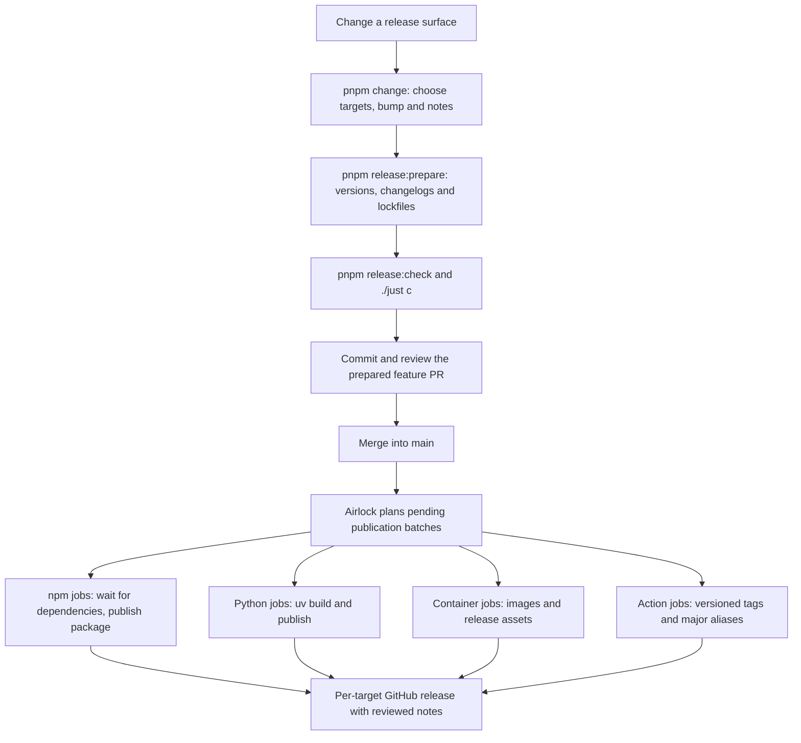

# Airlock

Airlock prepares reviewed versions and changelogs with native pnpm, then publishes npm packages, Python packages, containers and GitHub Actions declared in `airlock-targets.toml`. Merging a prepared feature PR into `main` starts publication automatically.

*How does a code change become a published release?*



## Prepare a feature PR

1. Check `airlock-targets.toml` for the targets whose `surface` includes the changed files. Cerberus requires a version bump for every affected target.
2. Run `pnpm change`, select those targets and choose patch for fixes, minor for compatible features or major for breaking changes. Write a concise consumer-facing summary, including migration steps for breaking changes; pnpm adds the list marker. Use separate fragments when targets need different descriptions.
3. Run the commands below. Review the versions, dependency changes, changelog entries, `.changeset/ledger.yaml` and both lockfiles, then include those edits with the feature.
4. Submit the PR through the repository's normal review process. After merge, check the automatic release run and its per-batch summaries; each GitHub release should contain the prepared entry for that version.

```sh
pnpm release:prepare
pnpm release:check
./just c
```

Preparation invokes `pnpm version -r`, consumes change intents and propagates dependency versions. Set `versioning.changelog.storage: repository` in `pnpm-workspace.yaml` so generated changelogs are reviewed in the PR. Only declared release targets publish; private dependent workspaces can also receive version bumps. Zyplux's preparation script regenerates the resolved ESLint rules snapshot.

Python targets have a private pnpm tracking `package.json` beside `pyproject.toml`; preparation synchronizes the native Python version through uv. Checks reject unconsumed fragments, mismatched versions and missing or empty changelog entries.

If preparation needs regeneration, preserve the code and note text, restore generated release files to the current `main` baseline, recreate the fragments and rerun `pnpm release:prepare` after any preceding release publishes.

## Release surface validation

`pnpm exec airlock check-surface` enforces single-step version bumps against published releases and the pull request target branch. Set `GITHUB_BASE_REF` or pass `--base origin/main` to compare against a target branch; published versions also require unchanged release surfaces. Unpublished target-branch versions can be repaired without another bump.

Action targets require the GitHub CLI to read published releases. Authenticate locally with `gh auth login`; in CI, set `GH_TOKEN` to the workflow token with `contents: read` permission.

Cerberus's `release_surface_version_bump` bite runs `pnpm exec airlock check-surface --json` and reports its findings. Keep Airlock installed as a locked root development dependency. In zyplux, `workspace:*` runs the current source; consuming repositories run their installed npm version. The JSON command returns an array of `status` and `message` findings and exits unsuccessfully for failures or errors.

## Automatic publication

The [release workflow](../../.github/workflows/release.yml) has a planning job and a publication matrix. `airlock plan` validates prepared releases and emits `matrix` and `pending` action outputs. Each row contains the exact release tags, a stable concurrency ID, an environment and a runner. `airlock publish --batch JSON` validates that row against the checked-out configuration and publishes its selected targets.

Every target has its own publication job, concurrency ID and GitHub release. Environments default to `npm`, `pypi`, `ghcr` and `actions`; set `environment` on a target to override it. The shared setup supports Linux runners.

Planning selects pending targets without building or packing packages. Each npm job packs its target once, inspects the archive's manifest after lifecycle scripts and `beforePacking` hooks, then publishes that same archive. Declare workspace dependencies retained in `dependencies` or `optionalDependencies` as npm release targets; private implementation packages removed during packing need no release target. A matching retained dependency on a declared workspace package is treated as a release edge, regardless of local linking settings. Each job waits for those workspace versions and tarballs before uploading. Development-only dependencies do not delay publication. Missing dependencies are checked every ten seconds for up to sixty retries; failed dependencies block their consumers while unrelated jobs continue. Packing failures affect only their target's job. The bulk `airlock publish-npm` command orders its archives by dependency and rejects cycles.

Each successful job finalizes its target's release; a failing job leaves the other jobs running. Npm publication requires each target to match a non-private workspace package at its configured version. Native pnpm publishes the inspected archive and waits for registry metadata and tarball accessibility; Airlock verifies the requested version before creating its GitHub release. Existing npm versions can have their GitHub releases repaired without packing or uploading again. PyPI completion requires a wheel and source archive; uv retries incomplete uploads. Action publication creates a fixed versioned release and advances its compatible major alias to the newest published stable version. Package `prepack` hooks own npm builds and archive validation; publish-only lifecycle hooks are rejected before packing.

To recover from a failed run, fix the cause and rerun the failed jobs in GitHub Actions, or dispatch `release.yml` on `main` with an optional `tag` to select one release.

## Add Airlock to a repository

Add `@zyplux/airlock` as a locked development dependency, configure pnpm versioning and declare `airlock-targets.toml`. Use the [release workflow](../../.github/workflows/release.yml) as the consumer template, replacing its local action references with:

```yaml
- uses: zyplux/zyplux/apps/action-airlock@action-airlock-v1
  with:
    command: plan
```

The publishing step uses the same action with `command: publish` and `batch: ${{ toJSON(matrix) }}`. The action sets up cached pnpm and uv, installs locked dependencies, configures GitHub Packages authentication and runs the repository's installed CLI. Its `token` defaults to the job's GitHub token.

The calling workflow declares triggers, permissions, concurrency and environments. A single matrix uses their combined token permissions; separate job definitions can narrow permissions by publication kind. Keep OIDC publishing jobs in this top-level workflow to support PyPI trusted publishing.

Airlock supplies each npm scope's `publishConfig` registry to pnpm for preparation lookups. Targets in one scope must share a publication registry. Public npm and PyPI use trusted publishing; GitHub Packages and GHCR use the job token with `packages: write`.

## Add a release target

1. Add a named table with its kind, version source and release surface to `airlock-targets.toml`. The table name supplies the `<name>-v` tag prefix; its label defaults to `<scope>/<name>` and can be overridden explicitly.
2. Ensure pnpm discovers its version manifest. Python packages need the private tracking manifest described above; actions use a workspace `package.json`, with `private: true` when there is no npm package.
3. Complete the registry setup below, then prepare and merge the release through the feature PR procedure.

Set the top-level `scope` before the target tables:

```toml
scope = "@zyplux"

[airlock]
kind = "npm"
version = { file = "apps/airlock/package.json", json = "version" }
surface = ["apps/airlock", "apps/action-airlock"]
```

Actions also declare their GitHub `repository`. Airlock publishes as npm package `@zyplux/airlock` with `airlock-vX.Y.Z` tags; its action uses fixed `action-airlock-vX.Y.Z` tags and the `action-airlock-vX` alias. The package-manager action uses `setup-pm-vX.Y.Z` and `setup-pm-vX`.

## Container releases

Declare a GHCR target with a version source, release surface and image label:

```toml
[core]
kind = "ghcr"
label = "ghcr.io/zyplux/zyploop"
version = { file = "apps/zyp-loop/package.json", json = "version" }
surface = ["apps/zyp-loop", "packages/domain-model"]
dockerfile = "apps/zyp-loop/Dockerfile"
build_context = "."
```

Both build paths are relative to the repository root and must stay inside it. The build context defaults to the version file's directory. When `dockerfile` is omitted, Podman discovers `Containerfile` or `Dockerfile` in the build context.

Airlock authenticates GHCR, builds the versioned image with `org.opencontainers.image.version` and `org.opencontainers.image.revision` labels, and pushes it with Podman's `--digestfile`. It validates the returned SHA-256 digest and verifies registry availability before generating `release.json`:

```json
{
  "version": "1.2.3",
  "image": "ghcr.io/zyplux/zyploop@sha256:0123456789abcdef0123456789abcdef0123456789abcdef0123456789abcdef"
}
```

Airlock attaches this manifest to a draft GitHub release, then finalizes the release with its prepared changelog. Retrying an unfinished release rebuilds and records the newly pushed digest. Finalized releases retain their manifest and image; missing artifacts fail validation. `airlock publish-tagged-target --release TAG` runs the same container publication as the matrix job. Deployment consumes the manifest separately.

## Registry setup

### npm

For a new public package, run the `bootstrap-npm` workflow with its target label and the `NPM_TOKEN` secret. Then configure its trusted publisher on npmjs.com: owner and repository, workflow filename `release.yml`, direct publishing permission and an optional environment restriction matching the batch's environment. Subsequent versions use OIDC and automatic provenance.

The bootstrap token is only needed for first publication. Registry account authentication is required to configure trusted publishers.

### PyPI

Add a pending publisher before first publication: distribution name, owner and repository, workflow filename `release.yml` and environment `pypi` or the target's configured override. Preparing and merging the release publishes it with OIDC. PyPI requires no bootstrap token.
