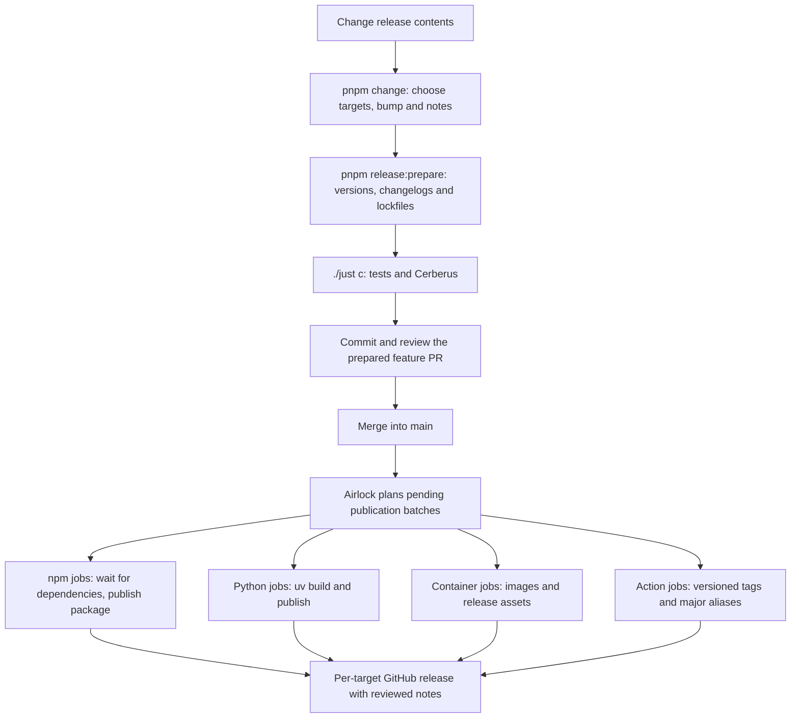

# Airlock

Airlock is a Python 3.14+ CLI. It prepares reviewed versions and changelogs with native pnpm, then publishes npm packages, Python packages, containers and GitHub Actions declared in `airlock-targets.toml`. Merging a prepared feature PR into `main` starts publication automatically.

*How does a code change become a published release?*



## Prepare a feature PR

1. Run `uv run cerberus --check release_surface_version_bump` to identify changed published targets.
2. Run `pnpm change`, select those targets and choose patch for fixes, minor for compatible features or major for breaking changes. Write a concise consumer-facing summary, including migration steps for breaking changes; pnpm adds the list marker. Use separate fragments when targets need different descriptions.
3. Run the commands below. Review the versions, dependency changes, changelog entries, `.changeset/ledger.yaml` and both lockfiles, then include those edits with the feature.
4. Submit the PR through the repository's normal review process. After merge, check the automatic release run and its per-batch summaries; each GitHub release should contain the prepared entry for that version.

```sh
pnpm release:prepare
./just c
```

Preparation invokes `pnpm version -r`, consumes change intents and propagates dependency versions. Set `versioning.changelog.storage: repository` in `pnpm-workspace.yaml` so generated changelogs are reviewed in the PR. Only declared release targets publish; private dependent workspaces can also receive version bumps.

Python targets have a private pnpm tracking `package.json` beside `pyproject.toml`; preparation synchronizes the native Python version through uv. Preparation initializes or refreshes every target's fingerprint after versioning. Cerberus's `release_readiness` bite rejects unconsumed fragments, mismatched versions, stale fingerprints and missing or empty changelog entries.

If preparation needs regeneration, preserve the code and note text, restore generated release files to the current `main` baseline, recreate the fragments and rerun `pnpm release:prepare` after any preceding release publishes.

## Release content validation

Cerberus's `release_surface_version_bump` bite enforces single-step version bumps against finalized GitHub releases and the pull request target branch. Set `GITHUB_BASE_REF` to compare against a target branch; published versions also require unchanged release contents. Target-branch versions can be repaired without another bump before their first registry upload. Once any package artifact exists, including an incomplete PyPI upload, the target branch's fingerprint must remain unchanged until that version's GitHub release is finalized.

`airlock prepare` records each target's `content_hash` in `airlock-targets.toml` after preparing versions, changelogs and lockfiles. Fingerprints use `sha256:<digest>`. Hashes cover sorted paths, file contents and executable permissions; source fingerprints also cover entry kinds and symlink destinations. Timestamps, ordering and compression are ignored. TOML comments and layout are preserved.

Package archives must exclude `airlock-targets.toml` to avoid self-referential fingerprints.

| Target | Fingerprinted contents |
| --- | --- |
| npm | The normal `pnpm pack` archive, including bundled code and package metadata. |
| Python | Both the wheel and source distribution produced by `uv build`. |
| Action | Git-visible files in the Action directory and the directory containing its version file, plus declared `runtime_files`. `path` selects the Action directory when it differs from the version directory. |
| Container | The selected build-context and Dockerfile paths, plus the Dockerfile and Git-visible build-context files, filtered with Docker's SDK matcher. `.containerignore` takes precedence over `.dockerignore`. |

Git-visible files include tracked files and new files permitted by Git's ignore rules. The release manifest is excluded from source fingerprints because it stores the fingerprints themselves. Action and container hashes are a best-effort check of local inputs: they do not follow dependencies outside these directories, resolve remote base images or execute container builds. Git submodule contents are outside the check's scope.

Python packages pin `uv_build` exactly in `build-system.requires`. uv uses that backend version even when its bundled backend differs, keeping wheel metadata and fingerprints consistent across preparation, CI and publication.

Bump detection is a best-effort reminder using prepared fingerprints; release readiness owns artifact validation. Cerberus compares each prepared fingerprint with the latest finalized stable GitHub release's tagged manifest, without rebuilding packages. The current PR's fingerprint cannot replace that baseline. One GitHub release-history lookup serves all targets; comparisons read Git history without downloading published artifacts. The first release with a fingerprint establishes the baseline; content comparisons begin after that release.

Preparation also records each package's `requires` list of matching workspace release tags from its built metadata. Cerberus's `release_readiness` bite requires and recalculates every target's fingerprint and package dependency list. Run `uv run cerberus --check release_readiness` for a focused readiness check. Publication verifies the same npm/Python archives it uploads and verifies Action/container inputs before publication. Build and fingerprint failures are errors.

Release checks require the GitHub CLI to read published releases. Authenticate locally with `gh auth login`; in CI, set `GH_TOKEN` to the workflow token with `contents: read` permission.

Cerberus reports release readiness and enforces the version-bump policy. It reuses Airlock's fingerprints, manifest parsing, GitHub release history and version parsing through its `zyplux-airlock` Python dependency.

Private GitHub registry reads use `NODE_AUTH_TOKEN` for npm, or `GH_TOKEN`/`GITHUB_TOKEN`, and otherwise reuse `gh auth token --hostname github.com`. Local users can sign in with `gh auth login --scopes read:packages`. Tokens need access to the package; Actions use the job token and package access granted to the repository. Explicit credentials take precedence, and registry failures remain errors.

## Automatic publication

The [release workflow](../../.github/workflows/release.yml) has a planning job and a publication matrix. `airlock plan` validates prepared releases and emits `matrix` and `pending` action outputs. Each row contains the exact release tags, a stable concurrency ID, an environment and a runner. `airlock publish --batch JSON` validates that row against the checked-out configuration and publishes its selected targets.

Every target has its own publication job, concurrency ID and GitHub release. Environments default to `npm`, `pypi`, `ghcr` and `actions`; set `environment` on a target to override it. The shared setup supports Linux runners.

Planning selects pending targets without building or packing packages. Each npm job packs its target once, inspects the archive's manifest after lifecycle scripts and `beforePacking` hooks, then publishes that same archive. Declare workspace dependencies retained in `dependencies` or `optionalDependencies` as npm release targets; private implementation packages removed during packing need no release target. A matching retained dependency on a declared workspace package is treated as a release edge, regardless of local linking settings. Each job waits for those workspace versions and tarballs before uploading. Development-only dependencies do not delay publication. Missing dependencies are checked every ten seconds for up to sixty retries; failed dependencies block their consumers while unrelated jobs continue. Packing failures affect only their target's job.

Each successful job finalizes its target's release; a failing job leaves the other jobs running. Npm publication requires each target to match a non-private workspace package at its configured version. Native pnpm publishes the inspected archive. Airlock verifies the exact version in registry metadata and uses GET to check tarball accessibility before creating its GitHub release. Airlock owns availability waiting; pnpm's HEAD-based wait is disabled because GitHub Packages rejects that method. Repairing a missing GitHub release for an existing npm or PyPI version rebuilds and validates its current fingerprint without uploading again. PyPI completion requires a wheel and source archive; uv checks the index to skip existing files when retrying incomplete uploads. Action publication creates a fixed versioned release and advances its compatible major alias to the newest published stable version. Package `prepack` hooks own npm builds and archive validation; publish-only lifecycle hooks are rejected before packing.

Python publication reads `Requires-Dist` from the built wheel and waits for matching versions of other configured PyPI targets before uploading those same archives. Matching dependencies include optional and conditional installations. The dependency's wheel and source archive must both be visible on PyPI; missing artifacts and transient registry failures use the same bounded wait as npm. A failed dependency blocks its consumers while unrelated jobs continue.

Each npm and Python job rejects cycles among its reachable unpublished workspace dependencies before waiting. Cycle checks use the prepared `requires` lists, validated against the actual archives during readiness checks and publication. Packing hooks, bundled dependencies and dynamic Python metadata are resolved during preparation; publication does not repack peer packages. Existing publications break dependency cycles; unrelated jobs remain independent.

To recover from a failed run, fix the cause and rerun the failed jobs in GitHub Actions, or dispatch `release.yml` on `main` with an optional `tag` to select one release.

## Add Airlock to a repository

Configure pnpm versioning and declare `airlock-targets.toml`. Cerberus includes Airlock in its Python dependencies, so repositories using Cerberus can run `uv run airlock`. For a standalone CLI, use `uv tool install zyplux-airlock`. Use the [release workflow](../../.github/workflows/release.yml) as the consumer template, replacing its local action references with:

```yaml
- uses: zyplux/zyplux/apps/action-airlock@action-airlock-v2
  with:
    command: plan
```

The publishing step uses the same action with `command: publish` and `batch: ${{ toJSON(matrix) }}`. Planning sets up uv and the publisher runtime. Publication also sets up pnpm, installs the repository's locked build dependencies and configures GitHub Packages authentication. It installs Airlock from the action's versioned source and `uv.lock` in a separate environment; the action reference selects the publisher version. Its `token` defaults to the job's GitHub token.

The calling workflow declares triggers, permissions, concurrency and environments. A single matrix uses their combined token permissions; separate job definitions can narrow permissions by publication kind. Keep OIDC publishing jobs in this top-level workflow to support PyPI trusted publishing.

Airlock supplies each npm scope's `publishConfig` registry to pnpm for preparation lookups. Targets in one scope must share a publication registry. Public npm and PyPI use trusted publishing; GitHub Packages and GHCR use the job token with `packages: write`.

## Add a release target

1. Add a named table with its kind and version source to `airlock-targets.toml`. The table name supplies the `<name>-v` tag prefix; its label defaults to `<scope>/<name>` and can be overridden explicitly.
2. Ensure pnpm discovers its version manifest. Python packages need the private tracking manifest described above; actions use a workspace `package.json`, with `private: true` when there is no npm package.
3. Complete the registry setup below, then prepare and merge the release through the feature PR procedure.

Version files and declared paths must be repository-relative and resolve inside the repository. Set the top-level `scope` before the target tables:

```toml
scope = "@zyplux"

[airlock]
kind = "pypi"
label = "zyplux-airlock"
version = { file = "apps/airlock/pyproject.toml", regex = '^version = "([^"]+)"' }
```

Actions also declare their GitHub `repository`, which must match the checkout because publication writes its release tags through `origin`. Set `path = "apps/action-airlock"` when the Action directory differs from its version-file directory. Declare installation inputs outside those directories with `runtime_files`; Airlock's action includes the root `pyproject.toml` and `uv.lock`. These files must exist inside the repository. Airlock publishes as Python distribution `zyplux-airlock` with `airlock-vX.Y.Z` tags; its action uses fixed `action-airlock-vX.Y.Z` tags and the `action-airlock-vX` alias. The package-manager action uses `setup-pm-vX.Y.Z` and `setup-pm-vX`.

## Container releases

Declare a GHCR target with a version source, build paths and image label:

```toml
[core]
kind = "ghcr"
label = "ghcr.io/zyplux/zyploop"
version = { file = "apps/zyp-loop/package.json", json = "version" }
dockerfile = "apps/zyp-loop/Dockerfile"
build_context = "."
```

Both build paths are relative to the repository root and must stay inside it. The build context defaults to the version file's directory. When `dockerfile` is omitted, Podman discovers `Containerfile` or `Dockerfile` in the build context.

Airlock authenticates GHCR, builds the versioned image with `org.opencontainers.image.version` and `org.opencontainers.image.revision` labels, and pushes it with Podman's `--digestfile`. It validates the returned SHA-256 digest and verifies registry availability before generating `release.json`:

```json
{
  "version": "1.2.3",
  "image": "ghcr.io/zyplux/zyploop@sha256:0123456789abcdef0123456789abcdef0123456789abcdef0123456789abcdef"
}
```

Airlock attaches this manifest to a draft GitHub release, then finalizes the release with its prepared changelog. Retrying an unfinished release rebuilds and records the newly pushed digest. Finalized releases retain their manifest and image; missing artifacts fail validation. Dispatch `release.yml` with the target tag to retry a container release. Deployment consumes the manifest separately.

## Registry setup

### npm

Follow the [manual first-publication guide](../../docs/guide/publish.md#first-npm-publication) to publish a new public npm package and configure trusted publishing for subsequent releases.

### PyPI

Add a pending publisher before first publication: distribution name, owner and repository, workflow filename `release.yml` and environment `pypi` or the target's configured override. Preparing and merging the release publishes it with OIDC. PyPI requires no bootstrap token.
